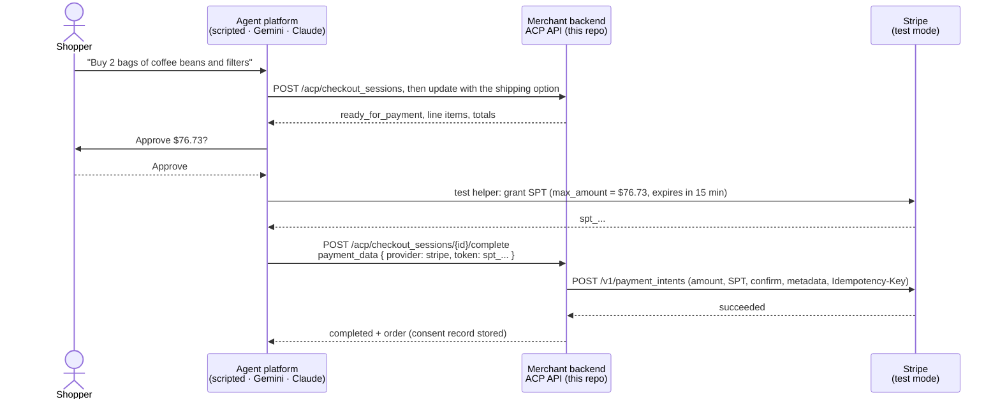
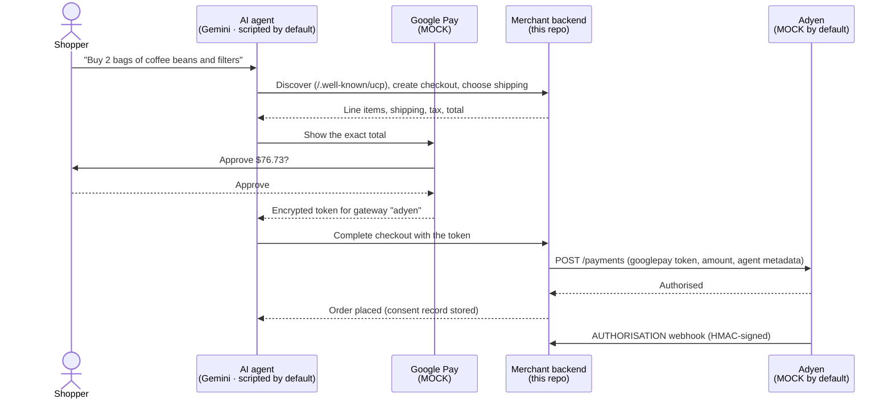

# Agentic payments: ACP with Stripe Shared Payment Tokens, Google UCP, and ACP via Adyen

**Question:** can an AI agent pay a merchant, and how small is the merchant side?
**Short answer from this repo:** small. An agent purchase ends as one ordinary payment call: a Stripe PaymentIntent confirmed with a Shared Payment Token, or an Adyen `POST /payments`. The **Stripe path runs against the real Stripe test API** (`npm run stripe:live`). The Adyen paths run only against a local mock, because Adyen test signup is closed.

> **What this proves / what it does not**
>
> | Proven by running this repo | Not proven |
> |---|---|
> | **Real provider:** a merchant-hosted ACP checkout charges a Stripe Shared Payment Token (SPT) as a real PaymentIntent in Stripe **test mode**, visible in the Dashboard. Refunds go to the real `/v1/refunds` | The SPT is granted by Stripe's **test helper**, standing in for the agent platform (for example OpenAI/ChatGPT). No real agent platform has issued a token to this merchant. Live keys are refused |
> | Stripe enforces the token's limits: single use, `max_amount`, expiry. A declined card is recoverable with a new token | Stripe webhooks (`payment_intent.*`, `shared_payment.granted_token.deactivated`) are not wired. An unknown outcome is resolved only by the agent's retry |
> | A merchant backend can expose Google UCP checkout and charge a Google Pay token through Adyen's documented `/payments` shape | No money, test or real, has moved through Adyen. Every `Authorised` comes from the local mock |
> | The LLM never sees card data or the SPT. The shopper approves the exact total, and a changed total is refused | The default demo has **no LLM**: it uses a scripted keyword matcher. Gemini and Claude run only with an API key |
> | Unknown outcomes (timeouts, 5xx) never double-charge, on Stripe and Adyen alike. Retries resend the same idempotency key | Google has never called this merchant. Gemini or AI Mode needs Google onboarding and a public HTTPS endpoint |
> | Each order stores a consent record (what was approved, when, shipped where, paid how) | The approval screen is simulated. In production Google owns it, not the merchant |
> | Refunds go back to Adyen, and the `REFUND` webhook marks the order refunded (mock) | 3-D Secure is detected but cannot be completed. Capture, disputes and settlement are absent |
> | ACP: the same purchase through a mock of Adyen's Commerce Suite | ACP hook paths differ from Adyen's merchant page (see the ACP section). Adyen must enable ACP per account |
>
> **Real provider run = `npm run stripe:live`:** a scripted agent, a merchant-hosted ACP checkout and a real Stripe test-mode PaymentIntent. It needs only a `sk_test_` key. **Default run (`npm run demo`) = scripted agent + mocked Google Pay + mocked Adyen.**

## Real provider: ACP checkout hosted by the merchant, paid with a Stripe Shared Payment Token

This is how ACP works with Stripe and OpenAI. The seller implements the ACP checkout API itself. The agent platform keeps the shopper's card and delegates payment as a Shared Payment Token: single use, scoped to this seller, capped by `max_amount`, and expiring. The seller charges the token with an ordinary PaymentIntent. Stripe docs: [Shared Payment Tokens](https://docs.stripe.com/agentic-commerce/concepts/shared-payment-tokens) (seller view: `?agent-seller=seller`).

```bash
# .env: STRIPE_SECRET_KEY=sk_test_...   (the account needs the agentic commerce preview)
npm run stripe:live          # starts the merchant, runs the scripted agent, prints the PaymentIntent
```

It ends with something like:

```
PaymentIntent:  pi_3U...
status:         succeeded
dashboard:      https://dashboard.stripe.com/test/payments/pi_3U...
```

To chat instead, run `PROTOCOL=stripe npm run servers`, then `PROTOCOL=stripe npm run agent -- "Buy 2 bags of the coffee beans and a pack of paper filters"` (add `--yes` to auto-approve). Without `STRIPE_SECRET_KEY`, the same commands use a local mock Stripe on port 8082, and `npm test` always does.



| | Real | Simulated |
|---|---|---|
| Stripe API calls (`/v1/payment_intents`, `/v1/refunds`) | yes, Stripe test mode with header `Stripe-Version: 2026-09-30.preview` | |
| PaymentIntents and refunds | yes, visible in the Stripe Dashboard (test mode) | |
| Token limits: single use, `max_amount`, expiry | enforced by Stripe | |
| The SPT grant | | `POST /v1/test_helpers/shared_payment/granted_tokens` with the seller's own test key, standing in for the agent platform. In production the agent platform (for example OpenAI) creates the token from the shopper's saved card; the seller never calls this |
| The shopper's card | | Stripe test PaymentMethod `pm_card_visa` (`AGENT_STRIPE_PAYMENT_METHOD`) |
| The agent and the approval screen | | scripted agent, auto-approved in `stripe:live`; in production the platform owns both |

**Merchant ACP API** (bearer `MERCHANT_ACP_API_KEY`, default `mock_merchant_acp_key`): `POST /acp/checkout_sessions`, `GET|POST /acp/checkout_sessions/:id`, `POST /acp/checkout_sessions/:id/complete` (with `Idempotency-Key`), `POST /acp/checkout_sessions/:id/cancel`. Statuses: `not_ready_for_payment`, `ready_for_payment`, `in_progress`, `completed`, `canceled`. Pricing, stock, the risk limit and the consent record are the same code as the Adyen ACP hooks.

**Outcomes of the PaymentIntent** (amount = the approved session total, `metadata` = `checkout_session_id`, `order_id`, `agent_protocol: ACP`, idempotency key `<session>-<order>`, fixed per payment attempt):

- `succeeded` → `completed` with `order`. The order stores the `pi_...` and the consent record.
- `requires_action` → back to `ready_for_payment` with a `requires_3ds` message. Nothing is charged; 3DS completion is not built.
- 4xx `card_error` (decline) or `invalid_request_error` (token used, expired, or over `max_amount`) → `ready_for_payment` with a recoverable `payment_declined` message. The agent asks the shopper to approve again and gets a new token.
- Timeout, network error, 5xx or 429 → stays `in_progress` with an info `payment_pending` message, stock stays reserved, and `cancel` is refused. Completing again with the same token resends the identical PaymentIntent request with the same idempotency key, so Stripe returns the first result instead of charging twice. The pay tool does this itself, without asking the shopper again. A different token gets 409.
- Other 4xx (bad API key, idempotency conflict) → `payment_failed`, nothing charged.

**Refund:** `POST /orders/:id/refund` on a Stripe order calls `POST /v1/refunds` with `payment_intent`. A synchronous `succeeded` sets `order.refund.status` to `refunded` and answers 200.

Checked live against the Stripe test API on 2026-11-21: grant, charge, reuse (400 "already in a deactivated state"), over-limit (400 "greater than the remaining amount capturable"), `pm_card_chargeDeclined` (402 `card_error` `card_declined`; the token stays active afterwards), `pm_card_authenticationRequired` (200 `requires_action`, `next_action.type: shared_payment_token_action`), refund. The local mock (`src/mock-stripe/server.ts`) reproduces these responses.

## The purchase, step by step (Google UCP, mocked)



## UCP or ACP?

| | **Google UCP + Google Pay** (default) | **ACP via Adyen** (secondary) |
|---|---|---|
| Who runs the checkout | The merchant's backend [doc] | Adyen Commerce Suite, which calls the merchant's hooks [doc] |
| Who authorises the payment | The merchant, with its own `/payments` call [doc] | Adyen in the standard flow, which Adyen recommends. The merchant in the advanced flow, which this POC defaults to [doc] |
| Merchant of record | The merchant ("You remain the Merchant of Record") [doc] | Not stated on Adyen's pages. Expected to be the merchant [assumption] |
| Fraud liability | The POC models `PAN_ONLY`, which has no liability shift. `CRYPTOGRAM_3DS` (Android device tokens) can shift it [doc] | Stored-credential charge without the shopper present (`ContAuth`), no 3DS. Fraud chargebacks are likely the merchant's [assumption] |
| PCI scope | Same as an existing Google Pay integration: the token is passed on unread [doc] | The merchant sees a token, not card numbers. The agent platform must be PCI DSS Level 1 [doc] |
| Reach | AI Mode in Google Search; Gemini app announced [doc] | Agent platforms that have integrated with Adyen [doc]. Which ones are live is not stated |
| Onboarding gate | Google Pay setup, Merchant Center feed, Google production access [doc] | Adyen account-manager enablement. Calls return 403 until then [doc] |
| Testable today without anyone's permission | Yes: the merchant → Adyen leg | No |

Recommendation: build UCP + Google Pay first. Ask Adyen about ACP enablement in parallel, because enablement has its own lead time.

## Run

Requires Node 23.6+ (TypeScript runs natively, no build step).

```bash
npm install
npm run stripe:live          # real provider: ACP + Stripe SPT against Stripe test mode (needs sk_test_ key)
npm run demo                 # UCP + Google Pay, scripted agent, auto-approved, full HTTP trace
PROTOCOL=acp npm run demo    # same purchase over ACP via the Adyen mock
PROTOCOL=stripe npm run demo # merchant-hosted ACP + Stripe (mock Stripe unless STRIPE_SECRET_KEY is set)
npm test                     # 97 tests, all offline: contract, end to end, HMAC vectors, config, LLM loops, Stripe SPT
```

To chat with a real agent, start the servers with `npm run servers`. Then, in another terminal:

```bash
GEMINI_API_KEY=... npm run agent -- "2 paket kahve çekirdeği ve filtre kağıdı al"
```

| `LLM_PROVIDER` | Cost | Key |
|---|---|---|
| `gemini` (default when a key is set) | free tier on Google AI Studio, rate limited | [aistudio.google.com/apikey](https://aistudio.google.com/apikey) |
| `claude` | paid API usage | `ANTHROPIC_API_KEY` |
| `scripted` | free, no LLM | none; deterministic keyword matcher used by tests |

`GEMINI_MODEL` / `CLAUDE_MODEL` override the model (Gemini default `gemini-3.6-flash`). Each Gemini request times out after 60 s with at most 3 attempts. If Google answers 503 "high demand" or a quota error, switch the model, for example `GEMINI_MODEL=gemini-3.5-flash-lite`. `ADYEN_MODE` (`mock` | `test`), `PROTOCOL` (`ucp` | `acp` | `stripe`) and `MERCHANT_FLOW` (`advanced` | `standard`) reject any other value at startup. `STRIPE_SECRET_KEY` must start with `sk_test_` (real Stripe test API) or be unset (local mock); a `sk_live_` key refuses to start, because live SPTs must come from a real agent platform. `STRIPE_API_BASE` overrides the Stripe host.

Stripe test PaymentMethods (set `AGENT_STRIPE_PAYMENT_METHOD`, real and mock): `pm_card_visa` succeeds, `pm_card_chargeDeclined` is declined, `pm_card_authenticationRequired` needs 3DS. Adyen mock test cards (set `AGENT_TEST_CARD`): `…1111` is authorised, `…0002` is refused for insufficient balance, and `…0044` triggers a 3-D Secure challenge (UCP: `requires_escalation`). Other things to try in chat: the out-of-stock gooseneck kettle, express shipping, changing quantities, closing the Google Pay sheet.

## Google UCP flow in detail

1. **Discover.** `GET /.well-known/ucp` lists the `dev.ucp.shopping` REST endpoint, the checkout and fulfillment capabilities, and a `com.google.pay` handler. That handler uses `PAYMENT_GATEWAY` tokenization with `gateway: adyen` and `gatewayMerchantId` set to the Adyen merchant account.
2. **Checkout.** `POST /checkout-sessions` returns `incomplete` with `missing` messages. `PUT /checkout-sessions/{id}` replaces the whole checkout; once a shipping option is selected, the status becomes `ready_for_complete`.
3. **Approve.** The Google Pay sheet shows the line amounts before tax, then shipping, tax and total, and these add up. It returns `credential: { type: "PAYMENT_GATEWAY", token }`.
4. **Complete.** `POST /checkout-sessions/{id}/complete` (with `Idempotency-Key`). The merchant forwards the token unchanged:
   ```json
   { "merchantAccount": "…", "amount": { "value": 7673, "currency": "USD" }, "reference": "ord_…",
     "paymentMethod": { "type": "googlepay", "googlePayToken": "<token>" },
     "returnUrl": "https://merchant/checkout/chk_…",
     "metadata": { "agentProtocol": "UCP", "agentSessionId": "chk_…", "agentPlatform": "Google" } }
   ```
5. **Outcome.**
   - `Authorised` → `completed`, with `order.id` and `order.permalink_url`. The checkout is frozen at the charged total.
   - `Refused` → stays `ready_for_complete` with a recoverable `payment_declined` message.
   - `Error` (Adyen answered 4xx, or could not be reached) → `payment_failed`. Nothing was charged, and the shopper is not asked for another card.
   - `RedirectShopper` (3-D Secure) → `requires_escalation` with a `continue_url`. Orders above the risk limit (`high_value_order`) escalate the same way.
   - Unknown outcome (timeout, HTTP 5xx, a 200 without a readable result, 422/704, `Pending`, `Received`) → stays `complete_in_progress` with an info `payment_pending` message. A `complete` with the same instrument resends the identical `/payments` request, with the same reference and idempotency key. The pay tool does this itself, without asking again, and returns the completed order if the webhook settled it first. Meanwhile, a different instrument and `cancel` get 409. With no retry and no webhook, the checkout stays pending and its stock stays reserved, because the payment may have been taken.
   - Stock is reserved during the Adyen call, so concurrent checkouts cannot oversell. Only a definitive result releases a reservation.
6. **Webhook.** The merchant verifies the HMAC signature. An `AUTHORISATION` webhook settles a pending payment only when its amount and currency match the pending payment. Without `ADYEN_HMAC_KEY`, every webhook is rejected (`ADYEN_WEBHOOK_INSECURE=1` opts out).

## ACP flow via Adyen (mock)

Adyen docs: [Agentic Cart API integration (merchant side)](https://docs.adyen.com/online-payments/agentic-commerce/merchant/agentic-cart-api-integration), and [AI agent integration with ACP (agent-platform side)](https://docs.adyen.com/online-payments/agentic-commerce/agent-platform/ai-agent-integration-acp).

The agent creates and updates the session on Adyen's Commerce Suite. Adyen asks the merchant for quotes. The agent tokenizes the card with `delegate_payment`: the token is single use, bound to the session and the merchant, and capped by `max_amount`. On complete, Adyen calls the merchant's commit hook (re-quote, reserve stock, store the approved total and the consent record) and then its finalize hook, which charges only the approved total.

In the advanced flow (the POC default) the merchant charges the token with `POST /payments`. Adyen recommends the standard flow, where Adyen authorises, unless the merchant must control the payment request (`MERCHANT_FLOW=standard`). On an unknown outcome, finalize answers `Pending` and keeps the approval and the reservation. Completing the session again resends the identical `/payments` request.

ACP webhooks are only attached to orders; they do not settle a pending ACP payment. Making them do so would need a second settle path in the merchant and in the mock Commerce Suite. That is listed under "Before production".

## After the order

- **Consent record.** `GET /orders/:id` returns `consent`: the protocol, the checkout id, the approved line items (before tax), subtotal, shipping, tax and total, the shipping address, the buyer email, the payment label (for example `Google Pay VISA •••• 1111`) and `approvedAt`. `approvedAt` is when the merchant received the approved completion (UCP complete, ACP commit); the platform sends no timestamp of its own.
- **Refund.** For Stripe orders, see the Stripe section. For Adyen orders, `POST /orders/:id/refund` refunds the full amount with Adyen `POST /payments/{pspReference}/refunds` (idempotency key `<order>-refund`). It answers 202 `received`, and the `REFUND` webhook then sets `order.refund.status` to `refunded` or `failed`. A second refund is refused with 409. The checkout's `terms_of_service` and `refund_policy` links (`/terms`, `/refunds`) serve placeholder text.

## Against Adyen's test environment

UCP path: the merchant talks to the real Checkout API, using a real Google Pay test token.

```bash
ADYEN_MODE=test ADYEN_MERCHANT_ACCOUNT=... ADYEN_CHECKOUT_API_KEY=... ADYEN_HMAC_KEY=... \
GOOGLE_PAY_TOKEN=@token.json npm run servers
```

Generate `token.json` with Google's Google Pay Code Generator, using gateway `adyen` and your merchant account as `gatewayMerchantId`. The token binds the gateway merchant and an expiry, not an amount: Adyen charges whatever amount the merchant sends. In test mode, `ADYEN_CHECKOUT_API_KEY` is required at startup, and no `mock_*` credential or default secret is ever used.

ACP path: also set `ADYEN_COMPANY_ACCOUNT`, `ADYEN_COMMERCE_SUITE_API_KEY`, `ADYEN_AGENTIC_TOKEN` and `MERCHANT_HOOK_SECRET`. Without the hook secret, every hook call is rejected. Adyen must enable Agentic Commerce for the account.

| Call | Test host | Auth |
|---|---|---|
| Checkout `/payments`, `/payments/{psp}/refunds` | `https://checkout-test.adyen.com/v72` | `X-API-Key` |
| ACP checkout sessions | `https://commerce-suite-test.adyen.com/commerce-suite/acp/v1/{companyAccount}` | `Authorization: Bearer` (Commerce Suite API role) |
| ACP `delegate_payment` | `https://pal-test.adyen.com/paltokenization/servlet/Recurring/Agentic/acp/v1` | `Authorization: Bearer` agentic token, `API-Version: 2025-09-29` |

## Confirmed by the docs vs our guess

Confirmed by the docs:

- UCP 2026-01-23: checkout endpoints and statuses, PUT as full replacement, message severities, the `PAYMENT_GATEWAY` credential at `payment.instruments[].credential.token`, the `com.google.pay` handler. The discovery `services` entry follows the overview page's profile example; the same page's field table describes a nested `rest.endpoint`, so the page contradicts itself.
- Adyen Google flow: `googlepay` + `googlePayToken`, `metadata.agentProtocol/agentSessionId/agentPlatform`, gateway `adyen`.
- Adyen ACP advanced flow `/payments` fields: `storedPaymentMethodId` (the token), `shopperReference` (the session id), `shopperInteraction: ContAuth`, `recurringProcessingModel: UnscheduledCardOnFile`. Also the `delegate_payment` request fields and token scoping.
- Webhook HMAC: the signing string order is pinned by a known-answer test (`test/unit.test.ts`), with the expected value computed separately with `openssl`.

Our guess, to confirm before production:

- ACP merchant hooks. The mock uses `/agentic/quote` plus `/agentic/sessions/{id}/commit` and `/finalize`, all with a bearer secret. Adyen's merchant page documents something else: `POST /agentic/sessions/{id}` for create and update, optional `commit` and `cancel`, `finalize` (standard flow), `complete` with the token (advanced flow), an `X-Merchant-Account` check on commit and finalize, and a five-second response limit. The mock's `delegate_payment` responses (201 with `created`/`metadata`; 400 `invalid_card`) also differ from Adyen's (200 with `id` and `expires_at`).
- UCP details that only appeared in summarised spec text: the postal address field names and the shape of the response `ucp` envelope.
- UCP deviations: `Idempotency-Key`, `Request-Id` and `Request-Signature` are required by the spec, but only `UCP-Agent` is required here. `continue_url` is sent only for `requires_escalation`. Version negotiation and `signing_keys` are not implemented. A duplicate `complete` while the first is running gets 409.
- The mock decrypts nothing: its Google Pay token wraps a base64 JSON payload. Its amount check is a stand-in; the real guard is the platform-side total check in the pay tool.
- Checkout API `v72`. The `RedirectShopper` → `requires_escalation` mapping is this POC's choice, and 3DS completion is not built.

## Before production

- **Stripe:** a webhook endpoint with signature verification for `payment_intent.succeeded` / `payment_intent.payment_failed` (to settle an `in_progress` session without the agent's retry) and `shared_payment.granted_token.deactivated`. ACP request signing and `API-Version` negotiation on the merchant ACP API. A real agent platform (for example OpenAI) as the token issuer, which ends the use of the test helper. The official `stripe` Node library behind the existing outcome mapping.
- **Payment attempts:** one persistent `PaymentAttempt` store shared by UCP and ACP, so webhooks can settle ACP too. Sessions, reservations (conditional decrement), orders and the idempotency cache move into the same database. Store the reference, amount and token hash, never the payment credential.
- **Webhooks:** a durable queue after HMAC verification, with dedupe, explicit handling of unknown references, and a reconciliation job for payments stuck in `complete_in_progress`. Handle `CAPTURE`, `CANCELLATION` and `CHARGEBACK`.
- **Adyen:** the official Node library for Checkout and HMAC, behind the existing outcome classification. Contract tests from recorded test-mode traffic. Live-endpoint URL prefix.
- **UCP:** `Request-Signature` verification, published `signing_keys`, an agent allow-list, idempotency scoped by verified agent, version negotiation.
- **State machine:** an explicit UCP status field with a transition table, instead of a status derived from several fields. Expiry moved out of reads, with an injected clock.
- **Config:** injected rather than global, loaded from a secret manager, with strict per-environment validation.
- **Back office:** authentication on `POST /orders/:id/refund` (open in this POC); partial refunds; capture on shipment.
- **Operations:** structured logs, metrics and traces keyed by checkout, merchant reference and pspReference. No internal details in 500 responses. Edge validation from the UCP/ACP OpenAPI schemas. `MerchantStore` split into catalog, pricing/tax, inventory and orders.
- **Risk:** 3DS completion on the escalation path, a configurable risk limit, and signals beyond order value.

## Layout

```
src/
  domain.ts                   neutral types: Item, Address, Buyer, Product, formatAmount
  ucp.ts, acp.ts              protocol wire types
  config.ts, http.ts          env (validated), JSON/form router, traced fetch with card and SPT redaction, idempotency cache
  stripe-api.ts               Stripe auth, Stripe-Version header, form-encoded calls
  stripe-live.ts              npm run stripe:live
  adyen-hmac.ts               webhook HMAC sign/verify
  google-pay-mock.ts          mock Google Pay token format
  mock-adyen/server.ts        fake Checkout /payments + refunds, ACP Commerce Suite, PAL, webhooks
  mock-stripe/server.ts       fake SPT test helper, token retrieve, PaymentIntents, refunds
  merchant/
    store.ts                  catalog, pricing, tax, shipping, orders with consent and refund
    ucp-server.ts             /.well-known/ucp and UCP checkout sessions
    acp-hooks.ts              quote/commit/finalize hooks Adyen calls for ACP; shared ACP pricing and approval
    acp-server.ts             merchant-hosted ACP checkout API (/acp/checkout_sessions) for Stripe
    adyen-checkout.ts         /payments and refund client
    stripe-payments.ts        PaymentIntent with an SPT, refund client
    payment-outcome.ts        provider-neutral result codes and unknown-outcome classification
    server.ts                 routes, refunds, webhook receiver
  agent/
    ucp/                      UCP client, Google Pay sheet, tools
    acp/                      ACP client (Adyen Commerce Suite or merchant-hosted), delegate_payment or SPT grant, tools
    llm/                      Gemini, Claude, scripted agents
    cli.ts, factory.ts, shopper.ts, toolset.ts
test/ucp.test.ts, acp.test.ts, stripe.test.ts, unit.test.ts, llm.test.ts, helpers.ts
```

All data is fake. Do not put real card numbers, real Google Pay tokens or Stripe keys in this repo; `.env` is git-ignored.
